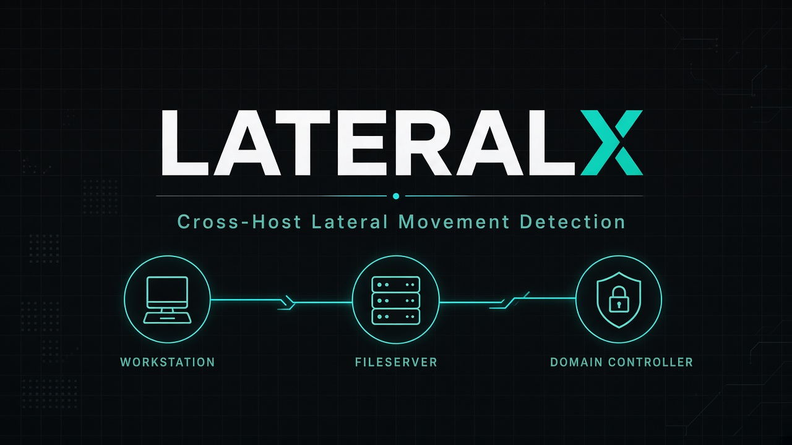

<p align="center">
  
</p>

<h1 align="center">LateralX</h1>

<p align="center">
  <strong>See the whole intrusion path — not just one alert.</strong><br/>
  Ingest Windows / Sysmon logs → correlate hosts &amp; identities → detect lateral movement → reconstruct the attack path.
</p>

<p align="center">
  <a href="https://github.com/yexploit/LateralX"></a>
  
  
  
  
</p>

---

## What is this?

Security tools often fire **isolated alerts** (weird login, remote process, failed auth).  
Real attackers move **across multiple machines** with a chain of mostly ordinary events.

**LateralX** is a blue-team investigation engine that:

1. **Ingests** real Windows Security / Sysmon telemetry (`.evtx`, `.xml`, `.json`, `.csv`)
2. **Normalizes & enriches** users, hosts, IPs, logon types, processes
3. **Builds an attack graph** (users ↔ hosts, observed vs inferred edges)
4. **Detects** lateral patterns (RDP, NTLM network logons, PsExec-style remoting, encoded PowerShell, credential dumping, DCSync, …)
5. **Reconstructs the path** with evidence-linked steps + response guidance

> This is **not** “type any internet IP and scan the world.”  
> It analyzes **the logs you give it**. After you ingest telemetry, those hosts / users / IPs become searchable.

---

## Quick start (Windows / Linux / macOS)

```bash
git clone https://github.com/yexploit/LateralX.git
cd LateralX
python -m pip install -r backend/requirements.txt
python start.py
```

That starts **UI + API on one port** and opens your browser:

| | URL |
|--|--|
| **App** | http://127.0.0.1:8000 |
| **API docs** | http://127.0.0.1:8000/docs |

Stop with `Ctrl+C`.

```bash
python start.py --port 8080
python start.py --host 0.0.0.0 --no-browser
```

---

## How to use (first investigation)

### 1) Start the tool
```bash
python start.py
```

### 2) Ingest your logs
Open the **Ingest** tab and upload:

- Windows Event Log → `.evtx`
- Event Viewer / wevtutil export → `.xml`
- PowerShell `Get-WinEvent` export → `.json` / `.jsonl`
- Flat exports → `.csv`

**Or CLI:**
```bash
cd backend
python ingest_cli.py C:\temp\Security.evtx
python ingest_cli.py /var/log/windows/ --replace
python ingest_cli.py ../samples/windows_security_export.json
```

### 3) Export logs from Windows (examples)
```powershell
wevtutil epl Security C:\temp\Security.evtx
wevtutil epl Microsoft-Windows-Sysmon/Operational C:\temp\Sysmon.evtx

Get-WinEvent -LogName Security -MaxEvents 2000 |
  ConvertTo-Json -Depth 6 |
  Out-File C:\temp\security.json -Encoding utf8
```

### 4) Investigate in the UI
| Control | What it does |
|--|--|
| **Filter type + value** | Slice by Username / Host / IP / Process / Event code *(only values present in your ingested logs)* |
| **Search path** | Ask “how did source reach target?” across the graph |
| **Left sidebar** | Detection views (RDP, NTLM, DCSync, failures, …) |
| **Center graph** | Users + hosts; solid edges = observed, dashed = inferred |
| **Right rankings** | Risk-ranked users and hosts |
| **Attack path** | Ordered movement timeline + response steps |
| **Findings** | Detections with severity + MITRE techniques |
| **Evidence** | Normalized events backing the graph |
| **Validation pack** | Optional synthetic check — not required for real use |

### Try the included sample
A real-format sample is already in the repo:

```bash
cd backend
python ingest_cli.py ../samples/windows_security_export.json --replace
```

Then in the UI search things that **exist in that sample**, for example:

- Host: `WORKSTATION-01`
- Username: `administrator`
- IP: `10.10.20.41`

---

## What detections look for

| Signal | Examples |
|--|--|
| Suspicious execution | Encoded PowerShell (`-Enc`, Base64 cradles) |
| Credential access | mimikatz / LSASS-style tooling patterns |
| Lateral auth | Type 3 (network) / Type 10 (RDP) logons with source host/IP |
| Remote execution | PsExec / PSEXESVC-style process patterns |
| Directory abuse | 4662 / DCSync-style replication indicators |
| Persistence / defense | Account create, audit policy change |
| Auth noise | Logon failure bursts |

---

## Architecture

```
Windows EVTX / Sysmon XML / JSON / CSV
        ↓
   Ingest + normalize + enrich
        ↓
  SQLite persistence (backend/data/)
        ↓
 Detect + NetworkX attack graph + path rebuild
        ↓
 Investigation UI (served by the same Python process)
```

| Layer | Tech |
|--|--|
| Engine | Python, NetworkX, Pydantic |
| API | FastAPI |
| Storage | SQLite |
| UI | React (prebuilt into `backend/app/web`) |
| Run | `python start.py` or Docker |

---

## Docker

```bash
docker compose up --build
```

Open **http://localhost:8000**

---

## API (selected)

| Method | Path | Purpose |
|--|--|--|
| `POST` | `/api/ingest/upload` | Upload a log file |
| `POST` | `/api/ingest/path` | Ingest a filesystem path |
| `DELETE` | `/api/ingest/clear` | Clear stored telemetry |
| `GET` | `/api/graph` | Attack graph |
| `GET` | `/api/findings` | Detections |
| `GET` | `/api/paths` | Reconstructed paths |
| `POST` | `/api/search/path` | Path between entities |

Full interactive docs: `/docs`

---

## Project layout

```
LateralX/
├── start.py                 # One-command launcher (Win/Linux/macOS)
├── assets/banner.png        # README banner
├── samples/                 # Example real-format export
├── backend/
│   ├── ingest_cli.py        # CLI ingest
│   ├── data/                # SQLite + uploads (created at runtime)
│   └── app/
│       ├── ingest/          # Parsers + ingest service
│       ├── engine/          # Enrich, detect, graph, paths
│       └── web/             # Built investigation UI
└── frontend/                # UI source (optional — only if you edit the UI)
```

### Rebuild UI after frontend edits
```bash
cd frontend
npm install
npm run build
# Windows
xcopy /E /I /Y dist\* ..\backend\app\web\
# Linux / macOS
cp -R dist/* ../backend/app/web/
```

---

## Notes

- Default startup does **not** auto-load fake demo data. Use **Ingest** (or the sample file) for real analysis.
- Optional synthetic validation: set `LATERALX_SEED_ON_STARTUP=true` or use the **Validation pack** tab.
- Built for blue-team learning, labs, and portfolio / SOC investigation demos. Not a replacement for a full enterprise SIEM.

---

## License

MIT © [yexploit](https://github.com/yexploit)
